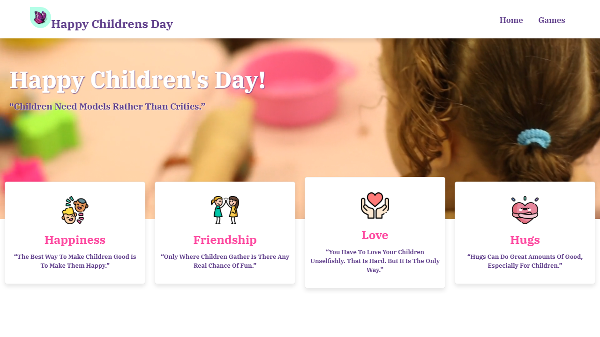

# Happy-Childrens-Day

**Live demo:** https://chandrasen74.github.io/Happy-Childrens-Day/  
**Repository:** https://github.com/Chandrasen74/Happy-Childrens-Day



## Overview
`Happy-Childrens-Day` is a HTML/CSS/JavaScript project.
- **Primary language:** CSS
- **Languages detected:** HTML, JavaScript, CSS
- **Stack/tech:** HTML, CSS, JavaScript
- **Entry point:** `index.html`
- **Key files:** `game/index.html`, `game1/index.html`, `index.html`, `mindcards/index.html`, `mine/index.html`, `tic toe/index.html`

## Language & stack details
- Languages: HTML, JavaScript, CSS
- Frameworks/tools/libraries: HTML, CSS, JavaScript

## How to install & run
### Prerequisites
- A modern web browser
- (Optional) [Python 3](https://www.python.org/) or any static file server for local serving

### Run locally
```bash
git clone https://github.com/Chandrasen74/Happy-Childrens-Day.git
cd Happy-Childrens-Day
```
- **Option 1:** open `index.html` directly in your browser
- **Option 2:** serve locally (recommended for some JS features):
```bash
python -m http.server 8000
# then open http://localhost:8000
```

## Repository structure (top-level/sample)
- `README.md`
- `game/Jquery.js`
- `game/cat.mp3`
- `game/cat.png`
- `game/dog.mp3`
- `game/dog.png`
- `game/elephant.mp3`
- `game/elephant.png`
- `game/home.png`
- `game/hyena.mp3`
- `game/hyena.png`
- `game/index.html`
- `game/index_ro.html`
- `game/lion.mp3`
- `game/lion.png`
- `game/pig.mp3`
- `game/pig.png`
- `game/script.js`
- `game/snake.mp3`
- `game/snake.png`
- `game/style.css`
- `game/tiger.mp3`
- `game/tiger.png`
- `game/zebra.mp3`
- `game/zebra.png`
- `game1/bg.jpg`
- `game1/home.png`
- `game1/index.html`
- `game1/purple.png`
- `game1/script.js`
- `game1/style.css`
- `images/animals_sound.jpg`
- `images/bg_heart.jpg`
- `images/donate-bg.jpg`
- `images/fit_shape.jpg`
- `images/footer-bg.jpg`
- `images/home-bg.jpg`
- `images/icon1.png`
- `images/icon2.png`
- `images/icon3.png`
- ... and 38 more file(s)

## Status
Documented with screenshot, language/stack details, and setup instructions as part of a profile-wide README update.
